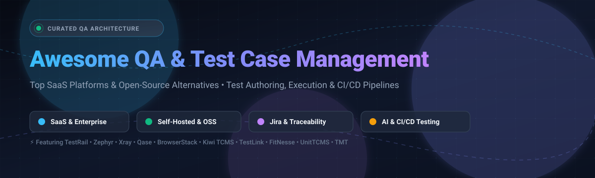

  

# Awesome QA Testing & Test Case Management 🚀

  
  
  
  
  

> 📚 A curated list of top QA Testing and Test Case Management (TCM) platforms, tools, and software — comparing both SaaS / cloud solutions and self-hosted open-source alternatives for test case authoring, execution tracking, test plans, and CI/CD automation integration.  
> 🌟 Star this repo if you find it useful! 🌟

---

## 📋 Table of Contents

- [📈 Sector Overview & Market Dynamics](#-sector-overview--market-dynamics)
- [🟦 SaaS / Hosted Platforms](#-saas--hosted-platforms)
- [🟩 Open-Source Software](#-open-source-software)
- [📊 Comparison at a Glance](#-comparison-at-a-glance)
- [🤝 Contributing](#-contributing)
- [💖 Support](#-support)
- [⭐ Star History](#-star-history)
- [📄 License](#-license)

---

## 📈 Sector Overview & Market Dynamics

The global dedicated test management software market is valued at approximately **$1.1 billion to $1.3 billion** (with the broader software testing and QA industry exceeding **$50 billion**), expanding at a CAGR of ~10–15% propelled by continuous integration, DevOps, and AI-driven testing workflows. The sector is **moderately fragmented**: while ecosystem heavyweights (such as Atlassian/Jira marketplace leaders, Idera, SmartBear, and Tricentis) capture large enterprise footprints, high agility requirements and API-first CI/CD pipelines enable innovative independent platforms (e.g., BrowserStack, Qase) and rich open-source solutions to command substantial developer mindshare rather than resulting in a single "winner-take-all" monopoly.

---

## 🟦 SaaS / Hosted Platforms

Commercial, cloud-hosted QA Testing and Test Case Management platforms. These are not open-source but are included as reference points for feature comparison.

| Platform | Company & Scale (Valuation / Revenue) | Deployment / Integration | Starting Price | Free Tier / Trial Limits | Key Features |
|---|---|---|---|---|---|
| **BrowserStack Test Management** | **BrowserStack** (~$4.0B valuation, ~$250M+ ARR) | Cloud (BrowserStack Ecosystem) | $29.80 / user / month ($149 / month for 5-user team pack) | Permanent Free tier: Up to 5 users, unlimited test cases, unlimited test runs, 10GB storage, 30-day run history | AI-assisted test authoring, rich media attachments, device cloud execution integration |
| **TestRail** | **Idera, Inc.** (~$3.0B valuation, ~$300M+ revenue) | Cloud / Server (Standalone) | $38 / user / month (Professional) or $25 / user / month (Essentials, up to 5 users) | 30-day free trial (Full features, no credit card required; no permanent free plan) | Structured test case repository, milestone runs, custom fields, audit logs, REST API |
| **Xray** | **Idera, Inc. / Xblend** (~$3.0B parent valuation, ~$300M+ corporate revenue) | Jira-native (Cloud / Data Center) | $10 / month flat base (Standard edition for 1–10 Jira users) | 30-day free trial on Atlassian Marketplace (All Jira users licensed; no permanent free plan) | Requirement-to-defect traceability, BDD/Gherkin support, CI/CD REST API, coverage reports |
| **Zephyr (Enterprise & Scale)** | **SmartBear Software** (~$1.8B–$2.0B valuation, ~$150M+ ARR) | Jira-native (Scale/Squad) & Standalone Cloud (Enterprise) | $10 / month flat base (Zephyr Scale for 1–10 Jira users) | 30-day free trial on Atlassian Marketplace (Matches host Jira user count; no permanent free plan) | Deep Jira ecosystem integration, traceability matrix, automated test execution results |
| **Qase** | **Qase Inc.** (~$42M valuation, ~$4.7M ARR) | Cloud (Standalone & Integrations) | $35 / user / month (Teams plan, min 5 seats; billed annually) | Permanent Free tier: Up to 4 users, 2 projects, 2 concurrent runs, 500MB storage, 30-day run history (also 14-day Teams trial) | Modern developer-first UI, automated test result ingestion, defect tracking, Jira/GitLab integration |

---

## 🟩 Open-Source Software

Self-hosted, community-driven QA Testing and Test Case Management tools. Sorted by GitHub_Stars in descending order:

### FitNesse 
**Stack:** Java | **License:** Open Source | **Repository:** [unclebob/fitnesse](https://github.com/unclebob/fitnesse)  
FitNesse is a fully integrated standalone wiki and acceptance testing framework. It functions as a collaboration tool where wiki pages run directly as tests against the application, enabling product owners, testers, and developers to collaboratively define acceptance tests and verify actual results without vendor lock-in. **Best for:** Teams wanting collaborative acceptance testing with business stakeholders in an interactive wiki format.

### TestLink 
**Stack:** PHP / MySQL | **License:** GPL-2.0 | **Repository:** [TestLinkOpenSourceTRMS/testlink-code](https://github.com/TestLinkOpenSourceTRMS/testlink-code)  
TestLink is a long-standing web-based test management system with requirements tracking, hierarchical test case organization, test prioritization, milestone definitions, and integration with bug trackers including Bugzilla, Jira, and Mantis. **Best for:** Budget-constrained teams with internal maintenance capability needing structured test case and execution tracking.

### Kiwi TCMS 
**Stack:** Python / Django / PostgreSQL | **License:** GPL-2.0+ | **Repository:** [kiwitcms/kiwitcms](https://github.com/kiwitcms/kiwitcms)  
Kiwi TCMS is the most widely adopted open-source test management system, featuring IEEE 829 compatibility, active community maintenance, and rich automation framework plugins. It offers multi-tenant progress tracking, test plans, test runs, and 1-click defect reporting directly into Jira, GitHub, GitLab, and Bugzilla. **Best for:** Teams wanting a proven, actively maintained enterprise-grade open-source TCMS.

### Macaca Reliable 
**Stack:** Node.js / Vue.js | **License:** MIT | **Repository:** [macacajs/reliable](https://github.com/macacajs/reliable)  
Reliable is an open-source test management suite and execution platform designed with continuous delivery support. It provides distributed testing cluster management, automated test execution dispatching, and test artifact aggregation. **Best for:** Distributed CI/CD pipelines and cross-platform automation test management.

### Tarantula 
**Stack:** Ruby on Rails | **License:** GPL-3.0 | **Repository:** [prove/tarantula](https://github.com/prove/tarantula)  
Tarantula is an open-source test management tool built for agile projects, featuring rich tagging, fuzzy test runs, requirements tracking, and integration with Jira, Bugzilla, and Redmine. **Best for:** Agile development teams looking for a fast, tag-oriented testing repository.

### TMT (Test Management Tool) 
**Stack:** Python / CLI | **License:** MIT | **Repository:** [teemtee/tmt](https://github.com/teemtee/tmt)  
TMT (Test Management Tool) is a modern test-management-as-code solution maintained under the Fedora/Red Hat ecosystem. It manages test metadata, plans, environments, and test execution directly alongside git repositories using human-readable YAML specifications. **Best for:** Engineering teams practicing GitOps and test-management-as-code directly in CI/CD.

### Quack 
**Stack:** Java / Spring Boot / React | **License:** Apache-2.0 | **Repository:** [greatbit/quack](https://github.com/greatbit/quack)  
Quack is a modern web-based test management system providing hierarchical test cases, launch execution plans, test case cloning, and seamless defect tracking integrations with Jira and tracker systems. **Best for:** Agile teams wanting a lightweight, clean web UI for manual and automated test suites.

### UnitTCMS 
**Stack:** TypeScript / Vue / Docker | **License:** MIT | **Repository:** [kimatata/unittcms](https://github.com/kimatata/unittcms)  
UnitTCMS is a lightweight, modern open-source test case management system designed specifically for secure, self-hosted environments. It offers project-based test suites, folder hierarchies, reusable test runs, and clean workflows without page-reload bloat. **Best for:** Teams looking for a clean, modern self-hosted interface with zero fuss.

### TestPlanIt 
**Stack:** TypeScript / Next.js / PostgreSQL / Docker | **License:** MIT | **Repository:** [TestPlanIt/testplanit](https://github.com/TestPlanIt/testplanit)  
TestPlanIt is a modern open-source test management platform built with Next.js and Prisma. It features rich-text test authoring (Tiptap), Git-driven impact analysis, CLI-based CI/CD result ingestion, and Jira Forge integration. **Best for:** Modern engineering organizations seeking a self-hosted alternative to proprietary platforms.

### Suitest 
**Stack:** Vite / React 19 / MCP-native | **License:** Apache-2.0 | **Repository:** [suiflex/suitest](https://github.com/suiflex/suitest)  
Suitest is a self-hostable, MCP-native testing platform featuring manual test management, deterministic runs, and optional AI integration. It supports execution across browsers (Playwright), APIs, mobile (Appium), and Kubernetes. **Best for:** Teams adopting Model Context Protocol (MCP) workflows with optional AI execution.

### Tesbo Test Manager 
**Stack:** TypeScript / Node.js | **License:** MIT | **Repository:** [QAbleHQ/Tesbo-Test-Manager](https://github.com/QAbleHQ/Tesbo-Test-Manager)  
Tesbo Test Manager is an open-source test case management platform designed for QA teams to self-host, organize test cycles, manage test cases, and integrate AI into QA workflows without vendor lock-in. **Best for:** Teams wanting customizable test cycle tracking and AI experimentation.

### Thorotest 
**Stack:** Python / FastAPI / Docker | **License:** MIT | **Repository:** [ecamuto/thorotest](https://github.com/ecamuto/thorotest)  
Thorotest is a self-hosted test management platform unifying manual and automated suites, requirements traceability, Jira & CI integration, and AI-assisted test generation (bring-your-own-API-key). **Best for:** Small teams seeking AI test authoring assistance with full local data privacy.

### QA Studio 
**Stack:** SvelteKit / PostgreSQL / Prisma | **License:** AGPL-3.0 | **Repository:** [QAStudio-Dev/studio](https://github.com/QAStudio-Dev/studio)  
QA Studio is a fast, API-first open-source test management platform built with SvelteKit. It supports hierarchical test suites, execution across multiple environments, rich media attachments (screenshots, videos, logs, stack traces), and Playwright integration. **Best for:** Teams prioritizing speed, modern developer stacks, and rich test run artifacts.

### ttgo 
**Stack:** Go / SQLite | **License:** PolyForm Noncommercial | **Repository:** [runetsk/ttgo](https://github.com/runetsk/ttgo)  
ttgo is an ultra-lightweight, self-hosted test management tool packaged as a single Go binary with SQLite. It offers test run execution, analytics with flaky-test detection, requirements traceability, and a CLI/REST API. **Best for:** Resource-constrained teams wanting a zero-maintenance, single-binary test management tool.

### Squash TM
**Stack:** Java / PostgreSQL/MySQL | **License:** LGPL-3.0 (open core) | **Source:** [GitLab HenixDevelopment](https://gitlab.com/henixdevelopment/squash/squash-tm-staging)  
Squash TM is a powerful open-core test management platform with a strong requirements-to-test traceability model, test campaign planning, and Jira synchronization. **Best for:** Agile teams using Jira that require formal requirement coverage verification.

### Tuleap
**Stack:** PHP / MySQL | **License:** GPL-2.0 (Community) / Commercial (Enterprise) | **Source:** [Tuleap Git](https://tuleap.net)  
Tuleap is an open-source Application Lifecycle Management (ALM) platform providing requirements, agile tracking, and test campaign planning. **Best for:** Compliance-focused organizations needing ALM traceability in a unified self-hosted platform.

---

## 📊 Comparison at a Glance

| Software | License | Stack | Requirements Traceability | Automation Integration | Self-Hosted | Best For |
|---|---|---|---|---|---|---|
| **FitNesse** | Open Source | Java | (Wiki-based) | ✅ Acceptance | ✅ | Collaborative acceptance testing |
| **TestLink** | GPL-2.0 | PHP / MySQL | ✅ Strong | DIY / API | ✅ | Budget OSS with basic needs |
| **Kiwi TCMS** | GPL-2.0+ | Python / Django | (IEEE 829) | ✅ Plugins | ✅ | Proven OSS test management |
| **Macaca Reliable** | MIT | Node.js / Vue | (CI/CD driven) | ✅ Distributed | ✅ | Distributed automation clusters |
| **Tarantula** | GPL-3.0 | Ruby on Rails | ✅ Tag-based | Redmine / Jira | ✅ | Fast agile test execution tracking |
| **TMT** | MIT | Python / YAML | ✅ Git-native | ✅ Native CI/CD | ✅ | Test-management-as-code & GitOps |
| **Quack** | Apache-2.0 | Java / React | ✅ Hierarchical | ✅ REST API | ✅ | Lightweight modern web TCMS |
| **UnitTCMS** | MIT | TypeScript / Vue | (Folder suites) | REST API | ✅ | Fast zero-bloat self-hosted TCMS |
| **TestPlanIt** | MIT | TypeScript / Next.js | ✅ Impact analysis | ✅ CLI / API | ✅ | Modern OSS alternative to TestRail |
| **Suitest** | Apache-2.0 | Vite / React | (MCP-native) | ✅ Multi-target | ✅ | MCP-native + optional AI |
| **Tesbo Test Manager** | MIT | TypeScript / Node.js | ✅ Modular | ✅ CI/CD | ✅ | AI-ready customizable test cycles |
| **Thorotest** | MIT | Python / FastAPI | ✅ Requirements | ✅ Jira / CI | ✅ | Self-hosted with BYO-AI test generation |
| **QA Studio** | AGPL-3.0 | SvelteKit / Postgres | ✅ Hierarchical | ✅ Playwright/API | ✅ | Fast modern self-hosted TCMS |
| **ttgo** | PolyForm Noncommercial | Go / SQLite | ✅ Traceability | ✅ CLI / REST | ✅ | Zero-maintenance single-binary TCMS |
| **Squash TM** | LGPL (core) | Java | ✅ Strong | ✅ (Squash AUTOM) | ✅ | Requirements + Jira coverage |
| **Tuleap** | GPL / Commercial | PHP / MySQL | ✅ Strong | ✅ ALM | ✅ | ALM + traceability (Enterprise test module) |
| **BrowserStack** | Proprietary | Cloud | (2-way binding) | ✅ Real devices | ❌ | BrowserStack device cloud users |
| **TestRail** | Proprietary | Cloud / Server | (Plugin) | CLI / REST API | ❌ | Dedicated standalone test management |
| **Xray** | Proprietary | Jira plugin | ✅ Strong | ✅ Native | ❌ | Requirements traceability in Jira |
| **Zephyr** | Proprietary | Jira plugin | ✅ Standard | ✅ CI/CD plugins | ❌ | Jira-centric large-scale test suites |
| **Qase** | Proprietary | Cloud | ✅ Traceability | ✅ API & Reporters | ❌ | Modern automation-first test management |

---

## 🤝 Contributing

Contributions are welcome! If you know of an open-source QA Testing or Test Case Management tool that should be listed here, please open a pull request with:

- Project name and URL
- Brief description (1–2 sentences)
- Stack and license
- Why it stands out

Please ensure the project is actively maintained (releases within the last 12 months) and genuinely open-source. Note that the open-source ecosystem offers strong options: **Kiwi TCMS** is the most mature and widely adopted open-source TCMS with IEEE 829 compatibility [citation:3], **TestLink** remains viable for budget-constrained teams with internal maintenance capability [citation:4][citation:11], **TestPlanIt** and **QA Studio** represent newer modern alternatives with active development [citation:1][citation:6], and **Squash TM** provides the strongest requirements-to-test traceability with Jira integration in its open-core edition [citation:7]. **Suitest** is notable for its MCP-native architecture with optional AI and broad execution target support [citation:15].

---

## 💖 Support

Thank you for exploring this curated repository! If this resource saved you time or helped you choose the right QA & Test Case Management solution, please consider supporting the project:

- ⭐ **Star this repository** to help others discover it!
- 🍴 **Fork and contribute** by adding new tools, guides, or updates.
- 📢 **Share** with fellow QA engineers, testers, and engineering teams.
- ☕ **Buy me a coffee**: If you appreciate this work, you can sponsor and support ongoing maintenance via the [GitHub Sponsors Dashboard](https://github.com/sponsors/ishandutta2007).

---

## ⭐ Star History

---

## 📄 License

This list is released under CC0 1.0 Universal (Public Domain). The software projects listed retain their respective licenses.

---

⭐ **If this list helped you discover a useful tool, please star the repo!** ⭐
